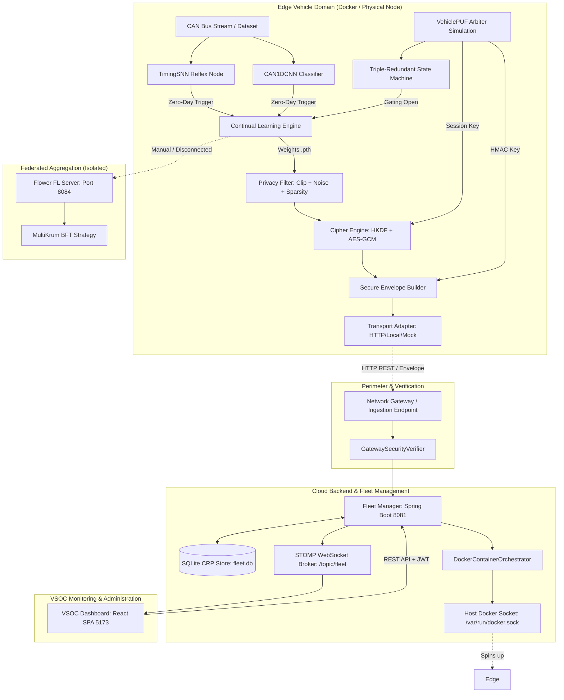
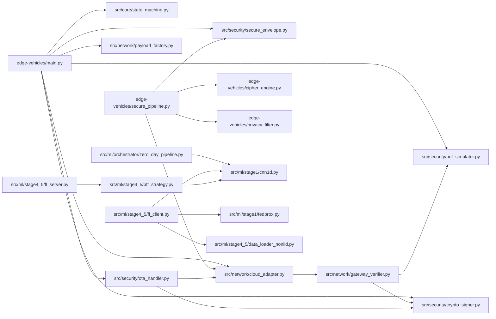
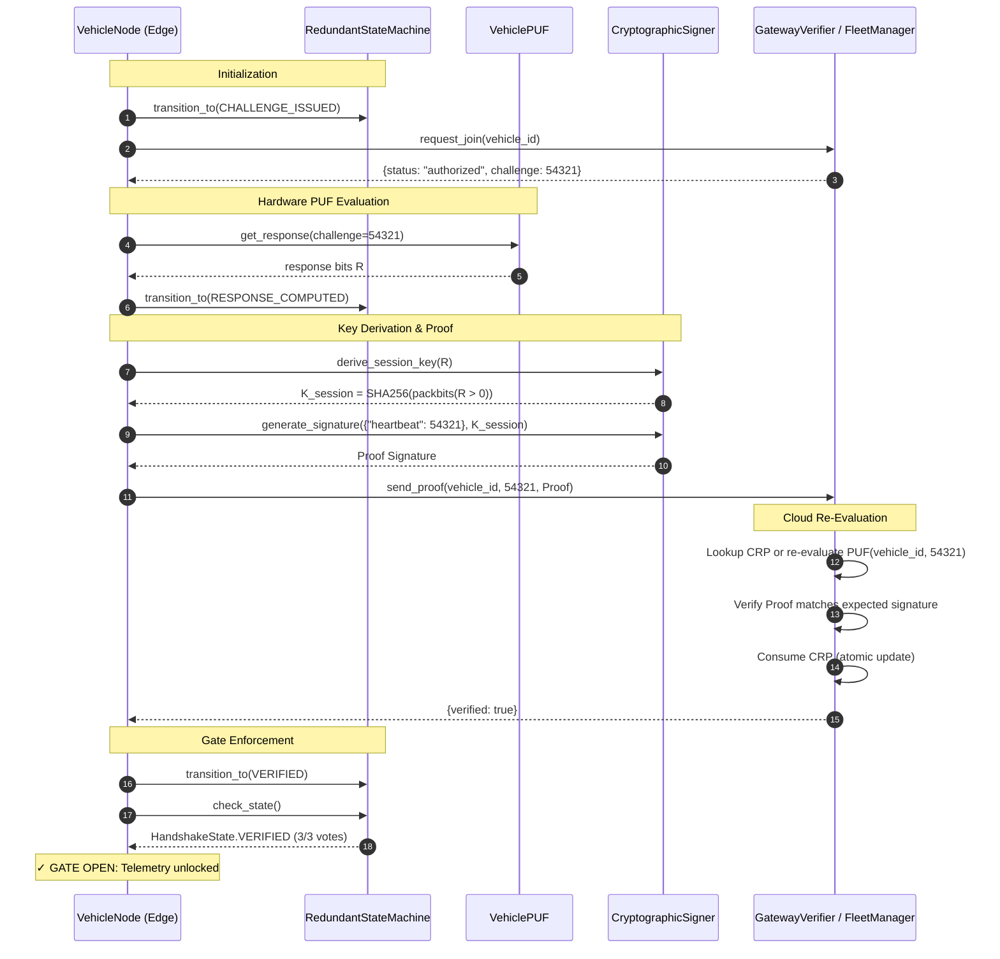
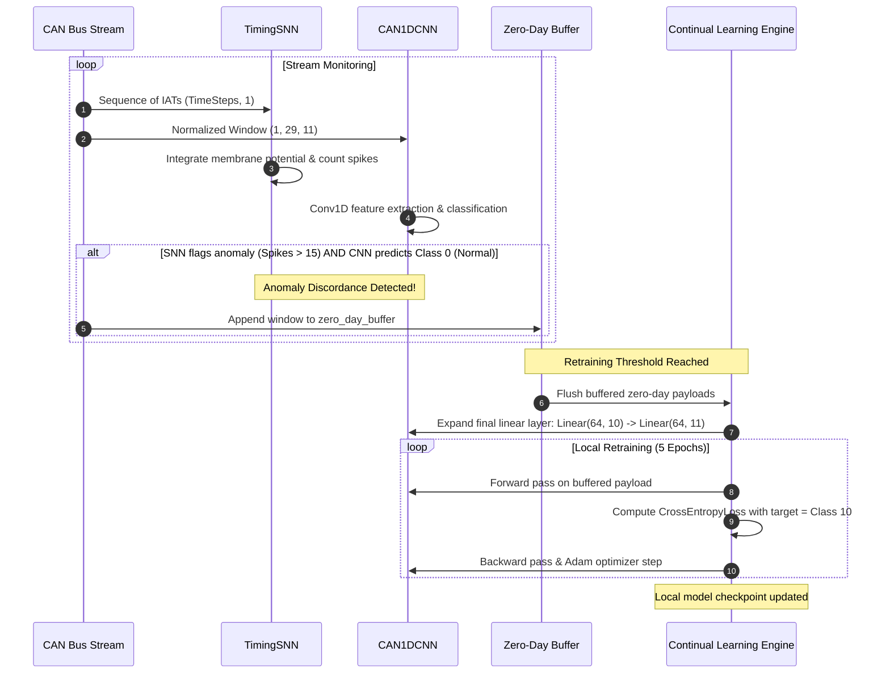
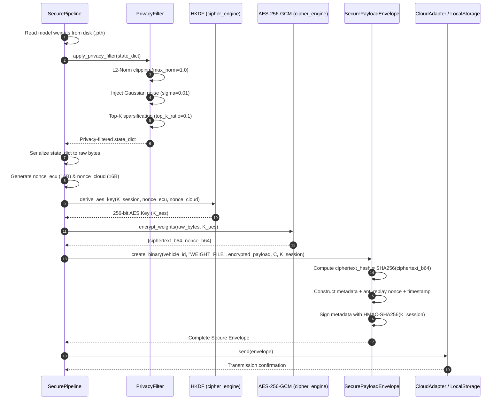
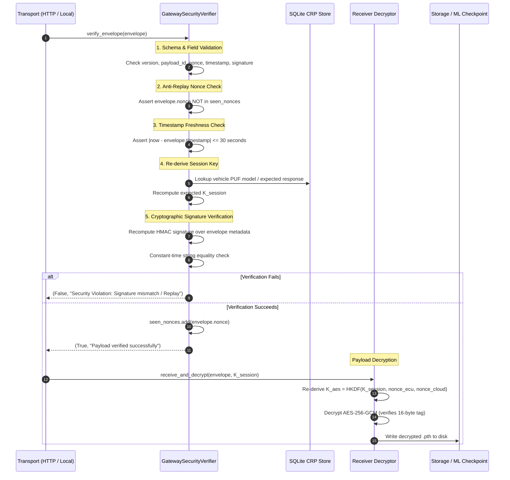
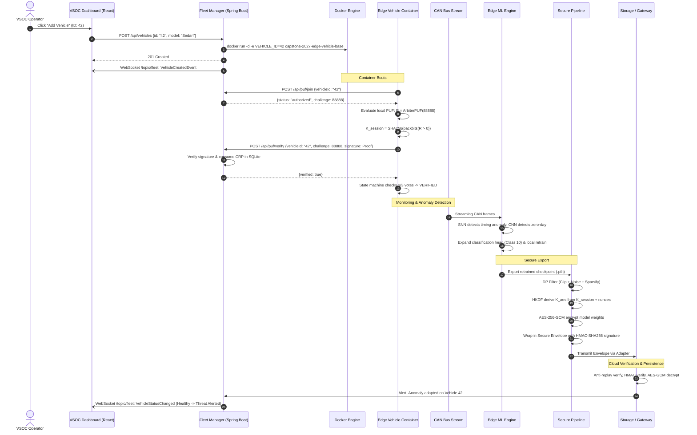

# Capstone 2027: VSOC Fleet Manager

Secure Edge-to-Cloud Vehicle Management System for the Vehicle Security Operations Center (VSOC).

## Overview

This project consists of:

- **Fleet Manager (Backend)**: A Spring Boot application providing the REST API and WebSocket connections for real-time fleet activity.
- **VSOC Dashboard (Frontend)**: A modern React/Vite web application providing an administrative interface.
- **Edge Vehicles**: Simulated vehicle environments deployed dynamically as Docker containers.
- **ML / PUF Simulations**: Python-based pipeline simulations for zero-day attacks and secure edge node handshakes.
- **Hardware PUF Simulation**: 32-bit Parallel Arbiter PUF gate-level simulation in Verilog with picosecond race resolution for fleet authentication.

---

## 🚀 Getting Started (Step-by-Step Guide)

Follow this sequential order to get the entire system running properly on your local machine. All commands are run through our unified startup script `start.ps1`.

### Step 1: Start Docker Desktop

Before running any scripts, ensure **Docker Desktop** is open and the engine is running. You should see a green "Engine running" indicator in the bottom left of the Docker UI. This is required to spin up the simulated edge vehicle containers.

### Step 2: Choose your Startup Mode

Open a PowerShell window in the root directory (`d:\capstone-2027`). You have two ways to start the primary application:

**Option A: Local Development Mode (Recommended for Code Editing)**
This runs the Spring Boot backend natively on port 8081 and the Vite React frontend natively on port 5173. It provides live-reloading.

```powershell
.\start.ps1 -Dev
```

**Option B: Full Docker Mode**
This bundles both the frontend and backend into Docker containers and runs them via docker-compose.

```powershell
.\start.ps1
```

### Step 3: Access the Dashboard

Once the startup script completes, the UI will be live.

- Open your browser and navigate to: **<http://localhost:5173>**
- Go to the **Fleet** tab to try adding a new vehicle (this will dynamically spin up a Docker container on your machine).

### Step 4: Run Machine Learning & PUF Simulations (Optional)

To test the Python-based edge ML simulations (PUF handshakes and Zero-Day Attack Neural Network retraining), open a **new** PowerShell window in the root directory and run:

```powershell
.\start.ps1 -MLSimulation
```

### Step 5: Run Automated Tests (Optional)

To verify the REST API is working correctly without using the UI, open a **new** PowerShell window and run the CRUD smoke tests:

```powershell
.\start.ps1 -TestOnly
```

---

## Shutting Down

- **If using `-Dev`**: Press `Ctrl+C` in your terminal to stop the local servers.
- **If using Docker**: Press `Ctrl+C` in your terminal, and the script will automatically run `docker-compose down` to clean up your environment.

---

## Utility Scripts

Standalone Python scripts live in the `scripts/` folder at the project root:

| Script | Purpose |
| -------- | --------- |
| `scripts/factory_enrollment.py` | Offline PUF CRP provisioning — seeds the SQLite DB with challenge-response pairs |
| `scripts/visualize_hardware_metrics.py` | Generates ArbiterPUF uniqueness/reliability graphs |
| `hardware-simulation/scripts/run_simulation.ps1` | Compiles & runs the 32-bit Parallel Arbiter PUF Verilog fleet simulation |

Run from the project root, e.g.:

```powershell
python scripts/factory_enrollment.py --vehicle-ids 1,2,3 --count 10000
python scripts/visualize_hardware_metrics.py
```

## Architecture Diagrams

### 1. Component-Level Architecture



### 2. Module Dependency Graph



### 3. Vehicle Authentication Sequence



### 4. CAN Intrusion Detection & Continual Learning Sequence



### 5. Secure Model-Update Transmission Sequence



### 6. Cloud Verification & Model Ingestion Sequence



### 7. Complete End-to-End Operational Lifecycle


